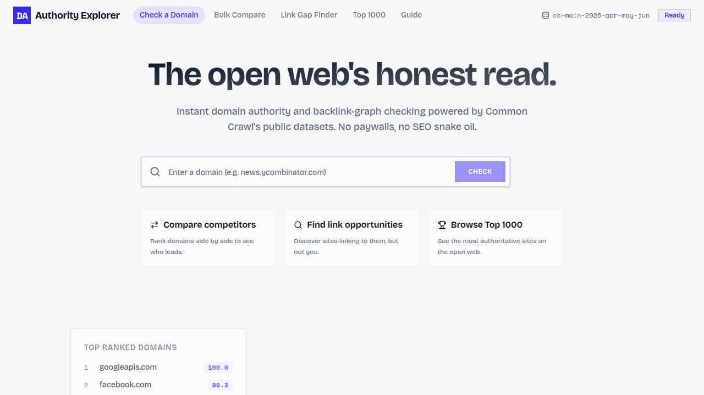

# Domain Authority Explorer

A free, open-data domain authority checker built on the [Common Crawl](https://commoncrawl.org/) web graph. Search any domain to see an Authority Score (harmonic centrality), a Popularity Score (PageRank), its global rank, monthly history back to 2018, and a bulk comparison of up to five domains. Built by [Khadija Zaman](https://khadijazaman.com/); listed with her other tools at [khadijazaman.com/tools](https://khadijazaman.com/tools/#open-source).



## Why

Proprietary authority scores are opaque and paywalled. Common Crawl publishes a host-level web graph of roughly 121 million domains with harmonic centrality and PageRank already computed. This project ingests those releases into PostgreSQL and serves them through a small API and a React front end, so anyone can read the same numbers the paid tools derive theirs from. How the scores are computed, and how they compare with commercial metrics, is in [`docs/how-it-works-and-benchmark.md`](docs/how-it-works-and-benchmark.md).

## Structure

pnpm workspace, Node 24, TypeScript 5.9.

- `artifacts/domain-authority-explorer/` — React + Vite front end (routes `/` explorer and `/compare`)
- `artifacts/api-server/` — Express 5 API: `/api/domain/:domain`, `/api/domain/:domain/history`, `/api/compare`, `/api/domains/top`, `/api/lookups/recent`, `/api/status`
- `scripts/src/sync-common-crawl.ts` — the Common Crawl sync job
- `lib/api-spec/openapi.yaml` — API contract; `lib/api-zod/` and `lib/api-client-react/` are generated from it
- `lib/db/` — Drizzle schema: `domainRanks`, `syncMeta`, `lookups`, `lookupsHistory`
- `packaging/` — a Chrome extension and a Google Sheets add-on that call the API

## Run

```bash
pnpm install
pnpm --filter @workspace/db run push                 # dev only: push the schema
pnpm --filter @workspace/scripts run sync            # ingest the latest Common Crawl web graph
pnpm --filter @workspace/api-server run dev          # API on port 5000
pnpm run typecheck && pnpm run build
```

Required environment: `DATABASE_URL` (PostgreSQL). The sync job downloads the current Common Crawl host-graph release, so allow disk and time for it.

## Licence

MIT. See `LICENSE`. Common Crawl data is used under Common Crawl's terms of use.
